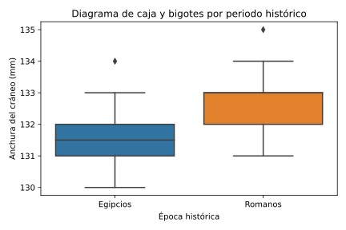

# ¿Cambió la anchura craneal entre dos periodos?

60 cráneos de un mismo yacimiento, medidos en milímetros, en dos muestras independientes
de 30: predinástico temprano y predinástico tardío. La pregunta es si la diferencia que se
ve en las medias es real o cabe dentro del azar muestral. Ejercicio del módulo de
*Estadística* del Máster en Big Data, Data Science e IA de la Universidad Complutense
(curso 2025-26).

| Grupo | n | Media (mm) | Desv. típica |
|---|---|---|---|
| Predinástico temprano | 30 | 131,53 | 0,82 |
| Predinástico tardío | 30 | 132,47 | 1,01 |

La diferencia estimada es de **−0,933 mm** y el intervalo de confianza no llega a incluir
el cero ni al 99 %. El t-Student para muestras independientes da t = −3,935 con 58 grados
de libertad y p = 0,00023. Se rechaza la igualdad de medias: los cráneos del periodo
tardío son, en promedio, alrededor de un milímetro más anchos.

Ahora la letra pequeña. Ese milímetro es pequeño comparado con lo que se mueve cada grupo
por dentro —desviaciones típicas de 0,8 y 1,0 mm—, así que la diferencia sale
estadísticamente significativa y a la vez tiene poca sustancia práctica. Con 30
observaciones por grupo, además, la potencia para detectar efectos de este tamaño es
limitada. El p-valor solo no cuenta esa parte.

## Cómo está hecho

El orden de los pasos condiciona la validez del resultado, así que va entero: descriptivos
por grupo (media, mediana, desviación, asimetría, curtosis y caja de bigotes), normalidad
con Kolmogorov-Smirnov, homocedasticidad con Levene para elegir entre
varianzas iguales y corrección de Welch, intervalos de confianza al 90, 95 y 99 %, y por
fin el contraste.

El notebook está en `src/`, los datos en `data/`, el informe en PDF en `reports/` y la
gráfica en `images/`. Python con pandas, SciPy y Seaborn.
